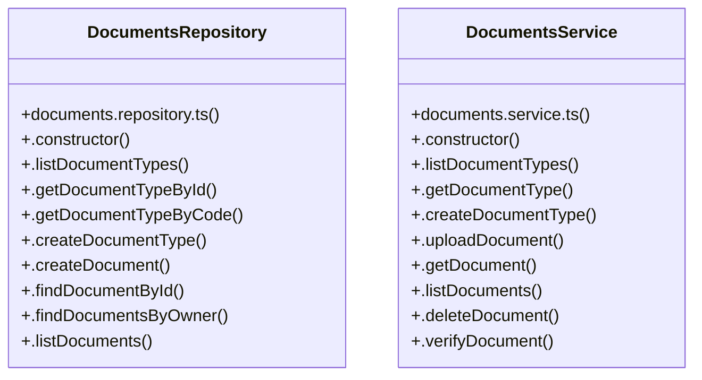

# [Document: Antigravity Master Prompt & 0. ROLE & OPERATING MODE] Cluster

> 54 nodes · cohesion 0.06

## Key Concepts

- [DocumentsRepository](file:///C:/Antigravityyyyy/VID_School/backend/src/modules/documents/documents.repository.ts#L74) (27 connections)
- [DocumentsService](file:///C:/Antigravityyyyy/VID_School/backend/src/modules/documents/documents.service.ts#L30) (22 connections)
- [.generateBonafideCertificate()](file:///C:/Antigravityyyyy/VID_School/backend/src/modules/documents/documents.service.ts#L406) (9 connections)
- [.verifyParentChildLink()](file:///C:/Antigravityyyyy/VID_School/backend/src/modules/examinations/examinations.repository.ts#L1074) (9 connections)
- [.generateTransferCertificate()](file:///C:/Antigravityyyyy/VID_School/backend/src/modules/documents/documents.service.ts#L512) (7 connections)
- [.requestDocument()](file:///C:/Antigravityyyyy/VID_School/backend/src/modules/documents/documents.service.ts#L610) (7 connections)
- [.verifyDocument()](file:///C:/Antigravityyyyy/VID_School/backend/src/modules/documents/documents.service.ts#L236) (7 connections)
- [.findDocumentById()](file:///C:/Antigravityyyyy/VID_School/backend/src/modules/documents/documents.repository.ts#L177) (6 connections)
- [.getDocumentTypeById()](file:///C:/Antigravityyyyy/VID_School/backend/src/modules/documents/documents.repository.ts#L93) (6 connections)
- [.uploadDocument()](file:///C:/Antigravityyyyy/VID_School/backend/src/modules/documents/documents.service.ts#L77) (6 connections)
- [.createDocument()](file:///C:/Antigravityyyyy/VID_School/backend/src/modules/documents/documents.repository.ts#L127) (5 connections)
- [.assertDocumentAccess()](file:///C:/Antigravityyyyy/VID_School/backend/src/modules/documents/documents.service.ts#L741) (5 connections)
- [.findTemplateById()](file:///C:/Antigravityyyyy/VID_School/backend/src/modules/documents/documents.repository.ts#L394) (4 connections)
- [.getDocumentTypeByCode()](file:///C:/Antigravityyyyy/VID_School/backend/src/modules/documents/documents.repository.ts#L103) (4 connections)
- [.getStudentCertificateDetails()](file:///C:/Antigravityyyyy/VID_School/backend/src/modules/documents/documents.repository.ts#L597) (4 connections)
- [.verifyStaffExists()](file:///C:/Antigravityyyyy/VID_School/backend/src/modules/documents/documents.repository.ts#L655) (4 connections)
- [.verifyStudentExists()](file:///C:/Antigravityyyyy/VID_School/backend/src/modules/documents/documents.repository.ts#L647) (4 connections)
- [.createDocumentType()](file:///C:/Antigravityyyyy/VID_School/backend/src/modules/documents/documents.service.ts#L52) (4 connections)
- [.deleteDocument()](file:///C:/Antigravityyyyy/VID_School/backend/src/modules/documents/documents.service.ts#L200) (4 connections)
- [.processDocumentRequest()](file:///C:/Antigravityyyyy/VID_School/backend/src/modules/documents/documents.service.ts#L698) (4 connections)
- [.createRequest()](file:///C:/Antigravityyyyy/VID_School/backend/src/modules/documents/documents.repository.ts#L485) (3 connections)
- [.findRequestById()](file:///C:/Antigravityyyyy/VID_School/backend/src/modules/documents/documents.repository.ts#L513) (3 connections)
- [.listRequests()](file:///C:/Antigravityyyyy/VID_School/backend/src/modules/documents/documents.repository.ts#L530) (3 connections)
- [.softDeleteDocument()](file:///C:/Antigravityyyyy/VID_School/backend/src/modules/documents/documents.repository.ts#L323) (3 connections)
- [.updateRequestStatus()](file:///C:/Antigravityyyyy/VID_School/backend/src/modules/documents/documents.repository.ts#L571) (3 connections)
- *... and 29 more nodes in this community*

## Class Diagram

## Relationships

- No strong cross-community connections detected

## Source Files

- [C:\Antigravityyyyy\VID_School\backend\src\modules\documents\documents.repository.ts](file:///C:/Antigravityyyyy/VID_School/backend/src/modules/documents/documents.repository.ts)
- [C:\Antigravityyyyy\VID_School\backend\src\modules\documents\documents.service.ts](file:///C:/Antigravityyyyy/VID_School/backend/src/modules/documents/documents.service.ts)
- [C:\Antigravityyyyy\VID_School\backend\src\modules\examinations\examinations.repository.ts](file:///C:/Antigravityyyyy/VID_School/backend/src/modules/examinations/examinations.repository.ts)
- [C:\Antigravityyyyy\VID_School\backend\src\modules\examinations\examinations.service.ts](file:///C:/Antigravityyyyy/VID_School/backend/src/modules/examinations/examinations.service.ts)

## Audit Trail

- EXTRACTED: 116 (52%)
- INFERRED: 106 (48%)
- AMBIGUOUS: 0 (0%)

---

*Part of the graphify knowledge wiki. See [[index]] to navigate.*