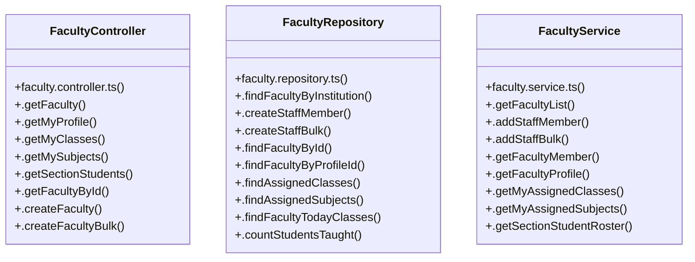

# [Document: Memory & 1.1 Architecture & Stack Contract] Cluster

> 32 nodes · cohesion 0.11

## Key Concepts

- [FacultyRepository](file:///C:/Antigravityyyyy/VID_School/backend/src/modules/faculty/faculty.repository.ts#L24) (11 connections)
- [FacultyController](file:///C:/Antigravityyyyy/VID_School/backend/src/modules/faculty/faculty.controller.ts#L5) (9 connections)
- [FacultyService](file:///C:/Antigravityyyyy/VID_School/backend/src/modules/faculty/faculty.service.ts#L3) (9 connections)
- [.getFacultyProfile()](file:///C:/Antigravityyyyy/VID_School/backend/src/modules/faculty/faculty.service.ts#L63) (8 connections)
- [.findFacultyByProfileId()](file:///C:/Antigravityyyyy/VID_School/backend/src/modules/faculty/faculty.repository.ts#L273) (5 connections)
- [.getFaculty()](file:///C:/Antigravityyyyy/VID_School/backend/src/modules/faculty/faculty.controller.ts#L6) (4 connections)
- [.createStaffMember()](file:///C:/Antigravityyyyy/VID_School/backend/src/modules/faculty/faculty.repository.ts#L81) (4 connections)
- [.findAssignedClasses()](file:///C:/Antigravityyyyy/VID_School/backend/src/modules/faculty/faculty.repository.ts#L287) (4 connections)
- [.findAssignedSubjects()](file:///C:/Antigravityyyyy/VID_School/backend/src/modules/faculty/faculty.repository.ts#L313) (4 connections)
- [.getMyAssignedClasses()](file:///C:/Antigravityyyyy/VID_School/backend/src/modules/faculty/faculty.service.ts#L107) (4 connections)
- [.getMyAssignedSubjects()](file:///C:/Antigravityyyyy/VID_School/backend/src/modules/faculty/faculty.service.ts#L115) (4 connections)
- [.createFaculty()](file:///C:/Antigravityyyyy/VID_School/backend/src/modules/faculty/faculty.controller.ts#L81) (3 connections)
- [.createFacultyBulk()](file:///C:/Antigravityyyyy/VID_School/backend/src/modules/faculty/faculty.controller.ts#L91) (3 connections)
- [.getFacultyById()](file:///C:/Antigravityyyyy/VID_School/backend/src/modules/faculty/faculty.controller.ts#L70) (3 connections)
- [.getMyClasses()](file:///C:/Antigravityyyyy/VID_School/backend/src/modules/faculty/faculty.controller.ts#L37) (3 connections)
- [.getMyProfile()](file:///C:/Antigravityyyyy/VID_School/backend/src/modules/faculty/faculty.controller.ts#L26) (3 connections)
- [.getMySubjects()](file:///C:/Antigravityyyyy/VID_School/backend/src/modules/faculty/faculty.controller.ts#L48) (3 connections)
- [.getSectionStudents()](file:///C:/Antigravityyyyy/VID_School/backend/src/modules/faculty/faculty.controller.ts#L59) (3 connections)
- [.countStudentsTaught()](file:///C:/Antigravityyyyy/VID_School/backend/src/modules/faculty/faculty.repository.ts#L365) (3 connections)
- [.createStaffBulk()](file:///C:/Antigravityyyyy/VID_School/backend/src/modules/faculty/faculty.repository.ts#L233) (3 connections)
- [.findFacultyById()](file:///C:/Antigravityyyyy/VID_School/backend/src/modules/faculty/faculty.repository.ts#L260) (3 connections)
- [.findFacultyByInstitution()](file:///C:/Antigravityyyyy/VID_School/backend/src/modules/faculty/faculty.repository.ts#L25) (3 connections)
- [.findFacultyTodayClasses()](file:///C:/Antigravityyyyy/VID_School/backend/src/modules/faculty/faculty.repository.ts#L332) (3 connections)
- [.findSectionStudents()](file:///C:/Antigravityyyyy/VID_School/backend/src/modules/faculty/faculty.repository.ts#L377) (3 connections)
- [.addStaffBulk()](file:///C:/Antigravityyyyy/VID_School/backend/src/modules/faculty/faculty.service.ts#L51) (3 connections)
- *... and 7 more nodes in this community*

## Class Diagram

## Relationships

- No strong cross-community connections detected

## Source Files

- [C:\Antigravityyyyy\VID_School\backend\src\modules\faculty\faculty.controller.ts](file:///C:/Antigravityyyyy/VID_School/backend/src/modules/faculty/faculty.controller.ts)
- [C:\Antigravityyyyy\VID_School\backend\src\modules\faculty\faculty.repository.ts](file:///C:/Antigravityyyyy/VID_School/backend/src/modules/faculty/faculty.repository.ts)
- [C:\Antigravityyyyy\VID_School\backend\src\modules\faculty\faculty.service.ts](file:///C:/Antigravityyyyy/VID_School/backend/src/modules/faculty/faculty.service.ts)

## Audit Trail

- EXTRACTED: 60 (49%)
- INFERRED: 63 (51%)
- AMBIGUOUS: 0 (0%)

---

*Part of the graphify knowledge wiki. See [[index]] to navigate.*