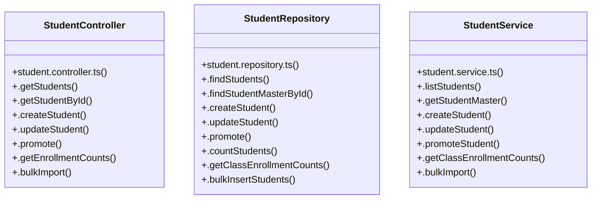

# [client & { id }] Cluster

> 31 nodes · cohesion 0.09

## Key Concepts

- [runVerification()](file:///C:/Antigravityyyyy/VID_School/backend/src/scripts/verify-3-admissions.ts#L6) (16 connections)
- [StudentRepository](file:///C:/Antigravityyyyy/VID_School/backend/src/modules/students/student.repository.ts#L14) (9 connections)
- [StudentController](file:///C:/Antigravityyyyy/VID_School/backend/src/modules/students/student.controller.ts#L5) (8 connections)
- [StudentService](file:///C:/Antigravityyyyy/VID_School/backend/src/modules/students/student.service.ts#L3) (8 connections)
- [.promote()](file:///C:/Antigravityyyyy/VID_School/backend/src/modules/students/student.controller.ts#L77) (4 connections)
- [.createStudent()](file:///C:/Antigravityyyyy/VID_School/backend/src/modules/students/student.repository.ts#L139) (4 connections)
- [.getStudentMaster()](file:///C:/Antigravityyyyy/VID_School/backend/src/modules/students/student.service.ts#L8) (4 connections)
- [.promoteStudent()](file:///C:/Antigravityyyyy/VID_School/backend/src/modules/students/student.service.ts#L22) (4 connections)
- [.bulkImport()](file:///C:/Antigravityyyyy/VID_School/backend/src/modules/students/student.controller.ts#L97) (3 connections)
- [.createStudent()](file:///C:/Antigravityyyyy/VID_School/backend/src/modules/students/student.controller.ts#L29) (3 connections)
- [.getEnrollmentCounts()](file:///C:/Antigravityyyyy/VID_School/backend/src/modules/students/student.controller.ts#L90) (3 connections)
- [.getStudentById()](file:///C:/Antigravityyyyy/VID_School/backend/src/modules/students/student.controller.ts#L22) (3 connections)
- [.getStudents()](file:///C:/Antigravityyyyy/VID_School/backend/src/modules/students/student.controller.ts#L6) (3 connections)
- [.bulkInsertStudents()](file:///C:/Antigravityyyyy/VID_School/backend/src/modules/students/student.repository.ts#L335) (3 connections)
- [.countStudents()](file:///C:/Antigravityyyyy/VID_School/backend/src/modules/students/student.repository.ts#L322) (3 connections)
- [.findStudentMasterById()](file:///C:/Antigravityyyyy/VID_School/backend/src/modules/students/student.repository.ts#L81) (3 connections)
- [.findStudents()](file:///C:/Antigravityyyyy/VID_School/backend/src/modules/students/student.repository.ts#L15) (3 connections)
- [.promote()](file:///C:/Antigravityyyyy/VID_School/backend/src/modules/students/student.repository.ts#L315) (3 connections)
- [.updateStudent()](file:///C:/Antigravityyyyy/VID_School/backend/src/modules/students/student.repository.ts#L271) (3 connections)
- [.bulkImport()](file:///C:/Antigravityyyyy/VID_School/backend/src/modules/students/student.service.ts#L31) (3 connections)
- [.getClassEnrollmentCounts()](file:///C:/Antigravityyyyy/VID_School/backend/src/modules/students/student.service.ts#L27) (3 connections)
- [.listStudents()](file:///C:/Antigravityyyyy/VID_School/backend/src/modules/students/student.service.ts#L4) (3 connections)
- [.createEnquiry()](file:///C:/Antigravityyyyy/VID_School/backend/src/modules/admissions/admissions.service.ts#L22) (2 connections)
- [.updateStudent()](file:///C:/Antigravityyyyy/VID_School/backend/src/modules/students/student.controller.ts#L67) (2 connections)
- [.getClassEnrollmentCounts()](file:///C:/Antigravityyyyy/VID_School/backend/src/modules/students/student.repository.ts#L327) (2 connections)
- *... and 6 more nodes in this community*

## Class Diagram

## Relationships

- No strong cross-community connections detected

## Source Files

- [C:\Antigravityyyyy\VID_School\backend\src\modules\admissions\admissions.service.ts](file:///C:/Antigravityyyyy/VID_School/backend/src/modules/admissions/admissions.service.ts)
- [C:\Antigravityyyyy\VID_School\backend\src\modules\students\student.controller.ts](file:///C:/Antigravityyyyy/VID_School/backend/src/modules/students/student.controller.ts)
- [C:\Antigravityyyyy\VID_School\backend\src\modules\students\student.repository.ts](file:///C:/Antigravityyyyy/VID_School/backend/src/modules/students/student.repository.ts)
- [C:\Antigravityyyyy\VID_School\backend\src\modules\students\student.service.ts](file:///C:/Antigravityyyyy/VID_School/backend/src/modules/students/student.service.ts)
- [C:\Antigravityyyyy\VID_School\backend\src\scripts\verify-3-admissions.ts](file:///C:/Antigravityyyyy/VID_School/backend/src/scripts/verify-3-admissions.ts)

## Audit Trail

- EXTRACTED: 55 (49%)
- INFERRED: 57 (51%)
- AMBIGUOUS: 0 (0%)

---

*Part of the graphify knowledge wiki. See [[index]] to navigate.*