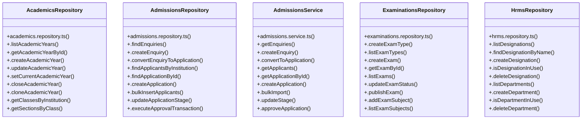

# [query & AcademicsRepository] Cluster

> 186 nodes · cohesion 0.02

## Key Concepts

- [query](file:///C:/Antigravityyyyy/VID_School/backend/src/modules/users/users.routes.ts#L446) (289 connections)
- [AcademicsRepository](file:///C:/Antigravityyyyy/VID_School/backend/src/modules/academics/academics.repository.ts#L3) (52 connections)
- [HrmsRepository](file:///C:/Antigravityyyyy/VID_School/backend/src/modules/hrms/hrms.repository.ts#L101) (40 connections)
- [ExaminationsRepository](file:///C:/Antigravityyyyy/VID_School/backend/src/modules/examinations/examinations.repository.ts#L121) (30 connections)
- [AdmissionsRepository](file:///C:/Antigravityyyyy/VID_School/backend/src/modules/admissions/admissions.repository.ts#L25) (18 connections)
- [AdmissionsService](file:///C:/Antigravityyyyy/VID_School/backend/src/modules/admissions/admissions.service.ts#L16) (15 connections)
- [.approveApplication()](file:///C:/Antigravityyyyy/VID_School/backend/src/modules/admissions/admissions.service.ts#L91) (10 connections)
- [.actionLeaveRequest()](file:///C:/Antigravityyyyy/VID_School/backend/src/modules/hrms/hrms.service.ts#L585) (8 connections)
- [.applyLeave()](file:///C:/Antigravityyyyy/VID_School/backend/src/modules/hrms/hrms.service.ts#L487) (8 connections)
- [.onboardStaff()](file:///C:/Antigravityyyyy/VID_School/backend/src/modules/hrms/hrms.service.ts#L140) (8 connections)
- [.calculateExamResults()](file:///C:/Antigravityyyyy/VID_School/backend/src/modules/examinations/examinations.repository.ts#L832) (7 connections)
- [.getStaffById()](file:///C:/Antigravityyyyy/VID_School/backend/src/modules/hrms/hrms.repository.ts#L282) (7 connections)
- [.createStaffDirect()](file:///C:/Antigravityyyyy/VID_School/backend/src/modules/hrms/hrms.service.ts#L229) (7 connections)
- [.updateStaff()](file:///C:/Antigravityyyyy/VID_School/backend/src/modules/hrms/hrms.service.ts#L376) (7 connections)
- [tenant-repository.base.ts](file:///C:/Antigravityyyyy/VID_School/backend/src/common/tenant-repository.base.ts#L1) (6 connections)
- [.publishExamResults()](file:///C:/Antigravityyyyy/VID_School/backend/src/modules/examinations/examinations.service.ts#L372) (6 connections)
- [.getAcademicYearById()](file:///C:/Antigravityyyyy/VID_School/backend/src/modules/academics/academics.repository.ts#L24) (5 connections)
- [.getWorkingDaysCount()](file:///C:/Antigravityyyyy/VID_School/backend/src/modules/academics/academics.repository.ts#L1141) (5 connections)
- [.getExamSubjectById()](file:///C:/Antigravityyyyy/VID_School/backend/src/modules/examinations/examinations.repository.ts#L320) (5 connections)
- [.linkFacultyRecord()](file:///C:/Antigravityyyyy/VID_School/backend/src/modules/hrms/hrms.repository.ts#L456) (5 connections)
- [.recordEmploymentHistory()](file:///C:/Antigravityyyyy/VID_School/backend/src/modules/hrms/hrms.repository.ts#L408) (5 connections)
- [.getBooklist()](file:///C:/Antigravityyyyy/VID_School/backend/src/modules/academics/academics.repository.ts#L1398) (4 connections)
- [.getCalendarConfig()](file:///C:/Antigravityyyyy/VID_School/backend/src/modules/academics/academics.repository.ts#L1044) (4 connections)
- [.listTextbooks()](file:///C:/Antigravityyyyy/VID_School/backend/src/modules/academics/academics.repository.ts#L1222) (4 connections)
- [.convertEnquiry()](file:///C:/Antigravityyyyy/VID_School/backend/src/modules/admissions/admissions.controller.ts#L32) (4 connections)
- *... and 161 more nodes in this community*

## Class Diagram

## Relationships

- No strong cross-community connections detected

## Source Files

- [C:\Antigravityyyyy\VID_School\backend\scripts\run-migration.ts](file:///C:/Antigravityyyyy/VID_School/backend/scripts/run-migration.ts)
- [C:\Antigravityyyyy\VID_School\backend\src\common\tenant-repository.base.ts](file:///C:/Antigravityyyyy/VID_School/backend/src/common/tenant-repository.base.ts)
- [C:\Antigravityyyyy\VID_School\backend\src\modules\academics\academics.repository.ts](file:///C:/Antigravityyyyy/VID_School/backend/src/modules/academics/academics.repository.ts)
- [C:\Antigravityyyyy\VID_School\backend\src\modules\admissions\admissions.controller.ts](file:///C:/Antigravityyyyy/VID_School/backend/src/modules/admissions/admissions.controller.ts)
- [C:\Antigravityyyyy\VID_School\backend\src\modules\admissions\admissions.repository.ts](file:///C:/Antigravityyyyy/VID_School/backend/src/modules/admissions/admissions.repository.ts)
- [C:\Antigravityyyyy\VID_School\backend\src\modules\admissions\admissions.service.ts](file:///C:/Antigravityyyyy/VID_School/backend/src/modules/admissions/admissions.service.ts)
- [C:\Antigravityyyyy\VID_School\backend\src\modules\examinations\examinations.repository.ts](file:///C:/Antigravityyyyy/VID_School/backend/src/modules/examinations/examinations.repository.ts)
- [C:\Antigravityyyyy\VID_School\backend\src\modules\examinations\examinations.service.ts](file:///C:/Antigravityyyyy/VID_School/backend/src/modules/examinations/examinations.service.ts)
- [C:\Antigravityyyyy\VID_School\backend\src\modules\hrms\hrms.repository.ts](file:///C:/Antigravityyyyy/VID_School/backend/src/modules/hrms/hrms.repository.ts)
- [C:\Antigravityyyyy\VID_School\backend\src\modules\hrms\hrms.service.ts](file:///C:/Antigravityyyyy/VID_School/backend/src/modules/hrms/hrms.service.ts)
- [C:\Antigravityyyyy\VID_School\backend\src\modules\users\users.routes.ts](file:///C:/Antigravityyyyy/VID_School/backend/src/modules/users/users.routes.ts)
- [C:\Antigravityyyyy\VID_School\backend\src\scripts\apply-010.ts](file:///C:/Antigravityyyyy/VID_School/backend/src/scripts/apply-010.ts)
- [C:\Antigravityyyyy\VID_School\backend\src\scripts\apply-012.ts](file:///C:/Antigravityyyyy/VID_School/backend/src/scripts/apply-012.ts)
- [C:\Antigravityyyyy\VID_School\backend\src\scripts\apply-013.ts](file:///C:/Antigravityyyyy/VID_School/backend/src/scripts/apply-013.ts)
- [C:\Antigravityyyyy\VID_School\backend\src\scripts\apply-014.ts](file:///C:/Antigravityyyyy/VID_School/backend/src/scripts/apply-014.ts)
- [C:\Antigravityyyyy\VID_School\backend\src\scripts\seed-hyderabad-demo.ts](file:///C:/Antigravityyyyy/VID_School/backend/src/scripts/seed-hyderabad-demo.ts)
- [C:\Antigravityyyyy\VID_School\backend\src\scripts\verify-r3-workspaces.ts](file:///C:/Antigravityyyyy/VID_School/backend/src/scripts/verify-r3-workspaces.ts)

## Audit Trail

- EXTRACTED: 396 (42%)
- INFERRED: 538 (58%)
- AMBIGUOUS: 0 (0%)

---

*Part of the graphify knowledge wiki. See [[index]] to navigate.*